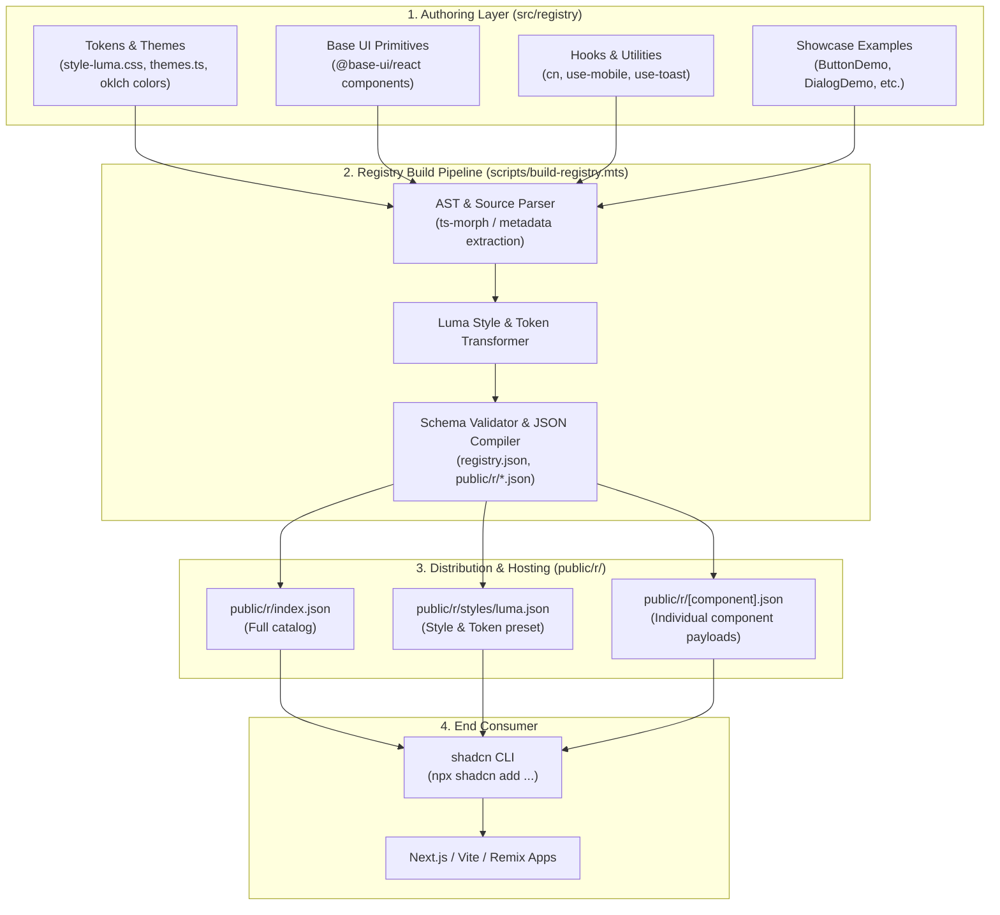

# karan-ui: Shadcn Component Registry Architecture & Implementation Plan (Phase 1: Luma Style)

## Goal Description
Build a production-grade, distributable **Shadcn Component Registry** named **`karan-ui`**. 
In Phase 1, the registry will achieve 100% aesthetic and functional parity with the **Shadcn v4 "Luma"** style ("Fluid, luminous, and soft") across all core components, design tokens (OKLCH color space, fluid radii, soft glow rings, pill geometries), theme presets, registry generation pipeline, and live interactive documentation/showcase.

The project is built on the modern stack:
- **Framework**: `next@latest` (App Router, Turbopack, React 19, TypeScript)
- **Styling**: `tailwindcss@latest` (Tailwind CSS v4 with `@theme`, OKLCH tokens, `@import "tailwindcss"`)
- **Primitives Foundation**: `base-ui@latest` (`@base-ui/react` - modern headless foundation)
- **Aesthetic**: Shadcn v4 **Luma** (`style-luma.css`, fluid pill silhouettes, luminous translucent surfaces, tactile micro-interactions)

When complete, external consumers will be able to install components directly into their projects via:
```bash
npx shadcn add https://karan-ui.dev/r/button.json
# or via configured namespace
npx shadcn add @karan-ui/button
```

---

## Architecture Overview



---

## Approved Technology Stack & Tooling

| Dimension | Selected Technology | Rationale |
| :--- | :--- | :--- |
| **Framework** | `next@latest` (Next.js 16+ App Router) | Native SSR/SSG, Turbopack, static `/r/*.json` endpoint hosting with zero extra backend. |
| **CSS Engine** | `tailwindcss@latest` (Tailwind CSS v4) | Zero-config CSS-first engine, native `@theme`, OKLCH color variables, modern `@apply`. |
| **Primitives** | `@base-ui/react@latest` | Modern headless UI foundation adopted by Shadcn v4, unstyled, accessible, robust. |
| **Design Style** | Shadcn v4 **Luma** | "Fluid, luminous, and soft" — `rounded-4xl` pills, soft focus glow, translucent blurs. |
| **Registry Schema** | Shadcn Registry Schema v1/v2 | Standard `registry.json` conforming to `shadcn/schema`. |
| **Code Parser** | `ts-morph` | AST-based metadata and dependency extraction for automated registry compilation. |

---

## Design System Specifications: Luma Style

### 1. Visual Signatures of Luma
- **Geometries**: Signature fluid, rounded pill silhouettes (`rounded-4xl`, `rounded-full` on buttons, switches, tags, and inputs; smooth `rounded-2xl` on cards and dialogs).
- **Color Space**: Full OKLCH palette with luminous contrasts, high-chroma focus rings, and soft ambient dark-mode elevated surfaces.
- **Lighting & Depth**: Frosted translucent backdrops (`bg-background/80 backdrop-blur-md`), `bg-clip-padding`, subtle border definition (`border-border/60`), and soft glow rings (`ring-ring/30 focus-visible:ring-3`).
- **Tactile Micro-interactions**: Active micro-translation (`active:not-aria-[haspopup]:translate-y-px`), smooth slider thumbs, springy switches.

### 2. Core Tokens Matrix (Light & Dark in OKLCH)

```css
@import "tailwindcss";

@theme inline {
  --radius-sm: 0.5rem;
  --radius-md: 0.75rem;
  --radius-lg: 1rem;
  --radius-xl: 1.5rem;
  --radius-4xl: 2rem;
}

:root {
  --background: oklch(1 0 0);
  --foreground: oklch(0.145 0 0);
  --card: oklch(1 0 0);
  --card-foreground: oklch(0.145 0 0);
  --popover: oklch(1 0 0);
  --popover-foreground: oklch(0.145 0 0);
  --primary: oklch(0.205 0 0);
  --primary-foreground: oklch(0.985 0 0);
  --secondary: oklch(0.97 0 0);
  --secondary-foreground: oklch(0.205 0 0);
  --muted: oklch(0.97 0 0);
  --muted-foreground: oklch(0.556 0 0);
  --accent: oklch(0.97 0 0);
  --accent-foreground: oklch(0.205 0 0);
  --destructive: oklch(0.577 0.245 27.325);
  --border: oklch(0.922 0 0);
  --input: oklch(0.922 0 0);
  --ring: oklch(0.708 0 0);
  --radius: 0.75rem;
}

.dark {
  --background: oklch(0.145 0 0);
  --foreground: oklch(0.985 0 0);
  --card: oklch(0.18 0 0);
  --card-foreground: oklch(0.985 0 0);
  --popover: oklch(0.18 0 0);
  --popover-foreground: oklch(0.985 0 0);
  --primary: oklch(0.985 0 0);
  --primary-foreground: oklch(0.205 0 0);
  --secondary: oklch(0.269 0 0);
  --secondary-foreground: oklch(0.985 0 0);
  --muted: oklch(0.269 0 0);
  --muted-foreground: oklch(0.708 0 0);
  --accent: oklch(0.269 0 0);
  --accent-foreground: oklch(0.985 0 0);
  --destructive: oklch(0.396 0.141 25.723);
  --border: oklch(0.269 0 0);
  --input: oklch(0.269 0 0);
  --ring: oklch(0.439 0 0);
}
```

---

## Detailed Implementation Roadmap

### Phase 1: Project Foundation & Registry Engine
1. **Initialize Project Infrastructure**:
   - Initialize Next.js 16 (`next@latest`, React 19, TypeScript, ESLint).
   - Setup Tailwind CSS v4 (`tailwindcss@latest`, `@tailwindcss/postcss`, `postcss`).
   - Install headless core: `@base-ui/react@latest`.
   - Install essential utilities: `clsx`, `tailwind-merge`, `class-variance-authority`, `lucide-react`.
2. **Setup Schema & Types**:
   - Implement `shadcn/schema` zod definitions:
     - `registryItemSchema` (types: `registry:ui`, `registry:style`, `registry:theme`, `registry:hook`, `registry:lib`, `registry:block`).
     - Registry manifest (`registry.json`).
3. **Build Registry Pipeline (`scripts/build-registry.mts`)**:
   - Component parser that scans `src/registry/` components.
   - Extracts component dependencies (`@base-ui/react`, etc.) and internal registry dependencies (`button`, `dialog`, etc.).
   - Generates individual JSON payloads in `public/r/[name].json`.
   - Generates master `public/r/index.json`.
   - Generates style bundle `public/r/styles/luma.json`.

### Phase 2: Complete Luma Style & Token Specification
1. **`src/registry/styles/style-luma.css`**:
   - Full Luma style specification covering:
     - `.style-luma` scope and global token variables.
     - `.cn-button`, `.cn-switch`, `.cn-slider`, `.cn-radio-group`, `.cn-checkbox`.
     - `.cn-dialog`, `.cn-card`, `.cn-popover`, `.cn-sheet`, `.cn-drawer`.
     - `.cn-tabs`, `.cn-accordion`, `.cn-command`, `.cn-table`, `.cn-badge`.
     - `.cn-input`, `.cn-textarea`, `.cn-select`, `.cn-calendar`, `.cn-tooltip`.
     - Tactile micro-interactions (active translates, smooth thumbs, soft glow).
2. **Theme Presets (`src/registry/themes.ts`)**:
   - Neutral, Zinc, Slate, Stone, Emerald, Rose, Violet, Blue palettes in OKLCH.

### Phase 3: Component Suite Implementation with Base UI (Full Parity)
The complete set of 50+ components authored under `src/registry/bases/base/ui/` with Luma styling:
- **Core Actions**: Button, Button Group, Toggle, Toggle Group.
- **Forms & Inputs**: Input, Input OTP, Input Group, Textarea, Checkbox, Radio Group, Switch, Slider, Select, Native Select, Combobox, Field, Label, Form.
- **Overlays & Dialogs**: Dialog, Alert Dialog, Sheet, Drawer, Popover, Tooltip, Hover Card, Context Menu, Dropdown Menu, Menubar.
- **Layout & Structure**: Card, Tabs, Accordion, Collapsible, Separator, Resizable, Scroll Area, Aspect Ratio.
- **Data & Feedback**: Table, Badge, Avatar, Skeleton, Progress, Toast, Alert, Kbd, Empty.
- **Navigation**: Breadcrumb, Pagination, Navigation Menu, Sidebar.
- **Advanced Primitives**: Calendar, Carousel, Chart integration.

### Phase 4: Showcase & Registry Distribution Portal
1. **Interactive Component Explorer**:
   - Interactive preview canvas with Luma theme switcher (Light / Dark, Accent color swatches).
   - Live code inspector with "Copy CLI Command" (`npx shadcn add ...`) and "Copy Code" buttons.
2. **Search & Filter**:
   - Fast instant search across all registry items.
3. **Registry Endpoint Verification**:
   - End-to-end testing of `npx shadcn add http://localhost:3000/r/button.json` into a clean test workspace to ensure zero-error installation.

---

## Proposed Project Directory Structure

```
KaranCraft/
├── .github/workflows/          # CI/CD for validation & registry deployment
├── public/
│   └── r/                      # Generated registry artifacts (served statically)
│       ├── index.json          # Complete index
│       ├── styles/
│       │   └── luma.json       # Luma style definition
│       ├── button.json         # Individual component definitions
│       ├── dialog.json
│       └── ...
├── scripts/
│   ├── build-registry.mts      # Registry compilation & transformation pipeline
│   └── validate-registry.mts   # Schema & dependency integrity validator
├── src/
│   ├── app/                    # Next.js showcase & documentation site
│   │   ├── layout.tsx
│   │   ├── page.tsx            # Hero, component browser & registry guide
│   │   └── docs/               # Component documentation pages
│   ├── components/             # Internal site components (navbar, previewer, etc.)
│   └── registry/               # SOURCE OF TRUTH for the registry
│       ├── bases.ts            # Base primitives definition (Base UI)
│       ├── themes.ts           # Theme colors & OKLCH variables
│       ├── styles/
│       │   └── style-luma.css  # Complete Luma style rules & classes
│       ├── lib/
│       │   └── utils.ts        # cn utility function
│       ├── hooks/
│       │   └── use-mobile.ts   # Shared hooks
│       ├── ui/                 # Component source files (Base UI + Luma)
│       │   ├── button.tsx
│       │   ├── dialog.tsx
│       │   ├── card.tsx
│       │   └── ... (all 50+ components)
│       └── examples/           # Component usage demos
│           ├── button-demo.tsx
│           ├── dialog-demo.tsx
│           └── ...
├── components.json             # Shadcn configuration
├── package.json
├── tsconfig.json
└── tailwind.config.ts / postcss
```

---

## Verification Plan

### Automated Tests
1. **Registry Schema Validation**:
   - Run `pnpm validate:registry` to verify all generated JSON files match Shadcn schema specification.
2. **Build Verification**:
   - Run `pnpm build` to ensure zero TypeScript errors and clean Next.js static asset generation.
3. **CLI Integration Test**:
   - Spin up local server, run `npx shadcn add http://localhost:3000/r/button.json` in a fresh test directory, verify imported code, dependencies, and styles resolve properly.

### Manual Verification
1. **Luma Aesthetic Fidelity**:
   - Visual inspection of pill buttons, focus rings, hover transitions, and dark mode luminance against official Luma specs.
2. **Accessibility**:
   - Keyboard navigation across Dialog, Dropdown, Tabs, Slider, and Switch primitives.
3. **Theme & Palette Switching**:
   - Verify dynamic switching between neutral, zinc, slate, and vibrant accent colors.
